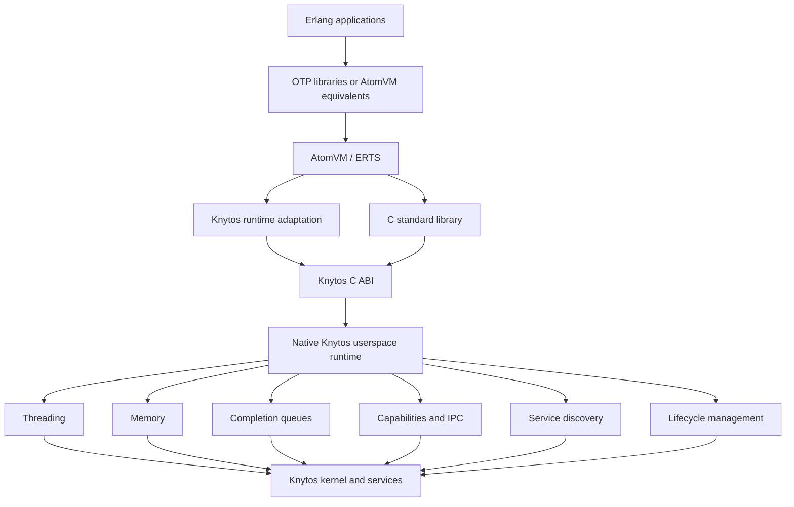
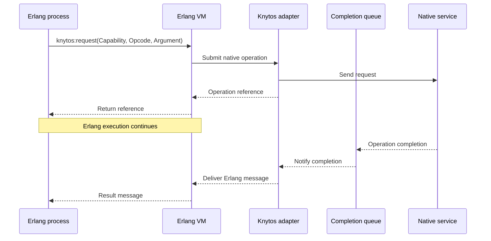
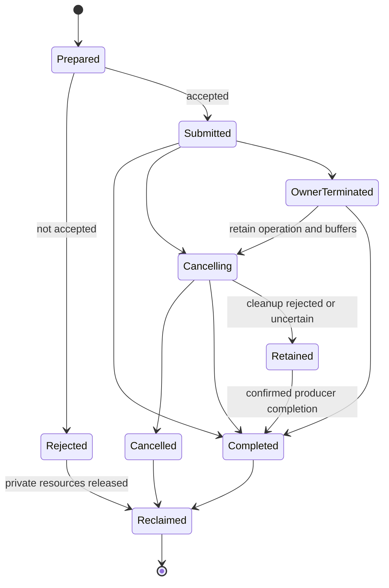
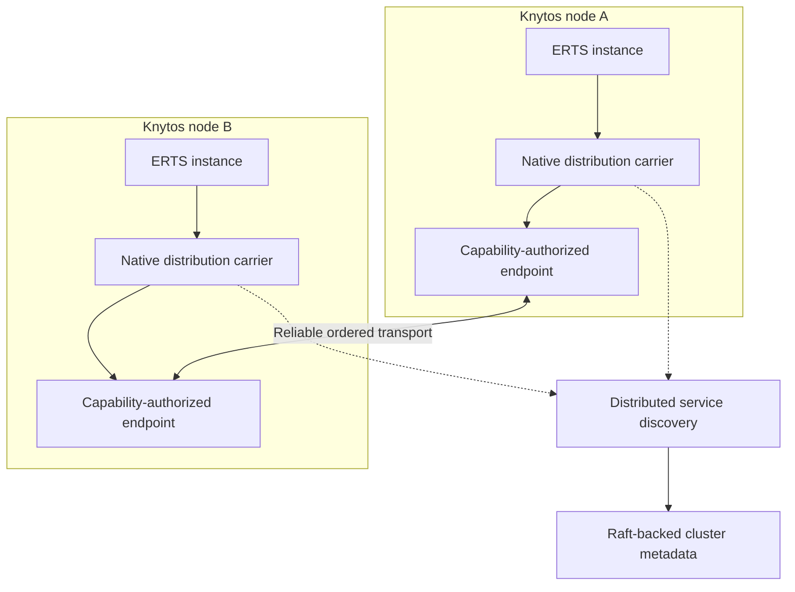
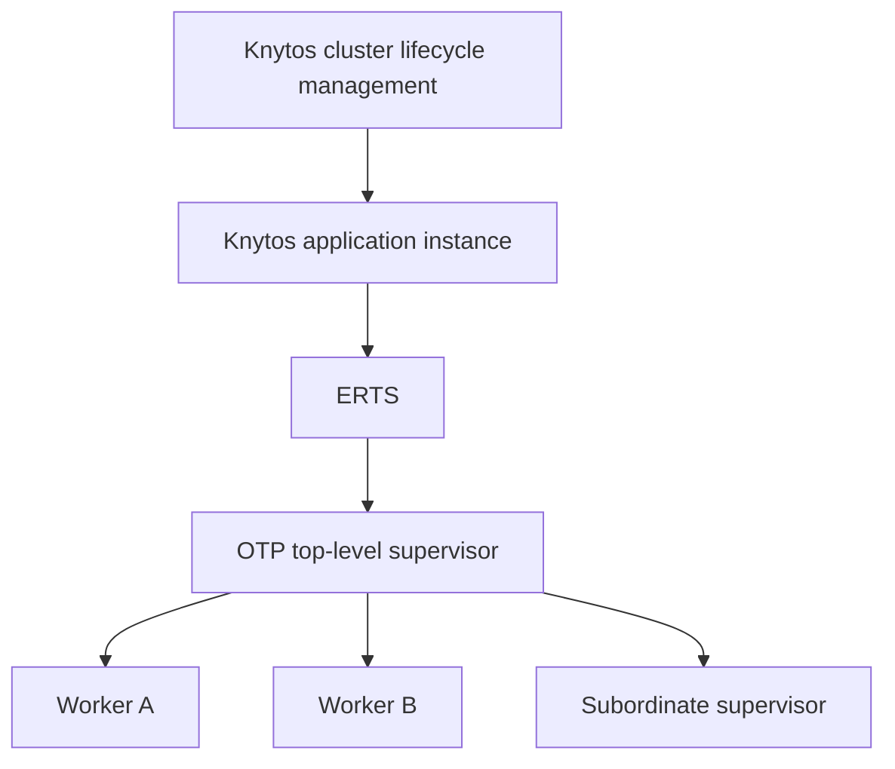
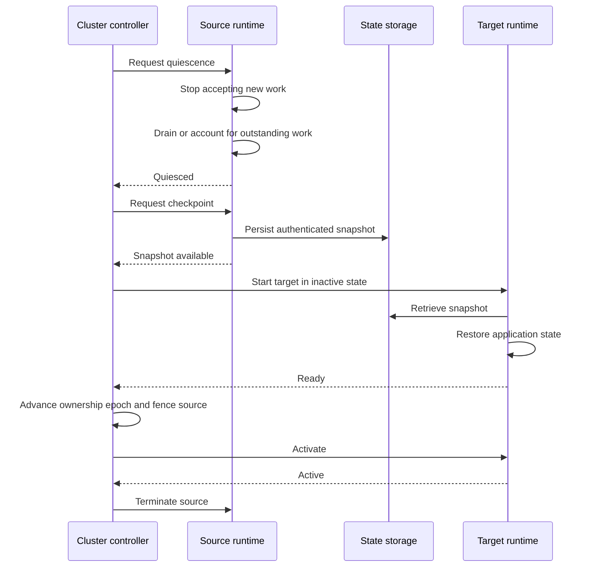
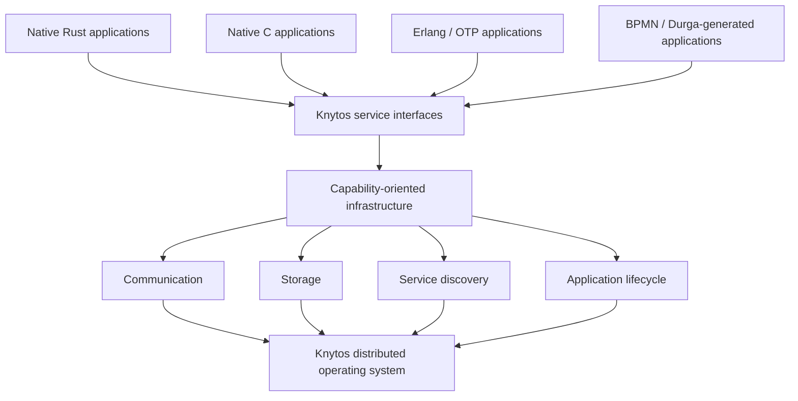
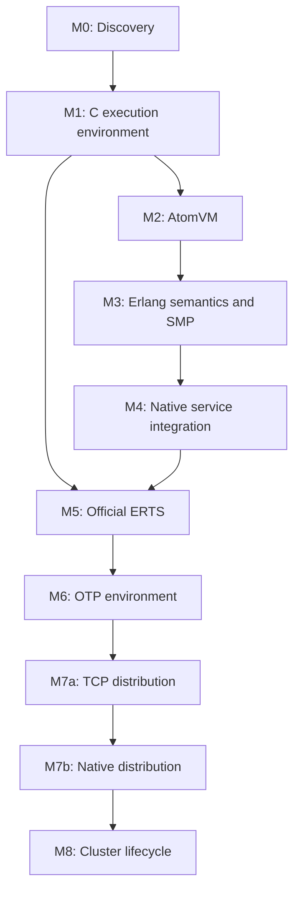

# Knytos — Native Erlang Runtime Support

## Implementation programme and architectural specification

**Status:** M0–M2 complete within qualified scope. M3 single-scheduler semantics qualified and fixed native SMP demonstrated. M4 passed for the single-scheduler service profile. M5's explicit native configure probe passes the thread-library gate and stops at the wall-clock-source gate.\
**Target platform:** Knytos, initially AArch64\
**Implementation languages:** Rust, C, Erlang\
**Initial runtime:** AtomVM\
**Long-term runtime:** Official Erlang Run-Time System (ERTS) and Erlang/OTP\
**Implementation strategy:** Incremental, test-driven, milestone-based

M0 findings are recorded in [Architecture discovery](erlang-m0-discovery.md).
The user reviewed M0 and authorized the [M1 implementation scope](erlang-m1-implementation.md).
The [M1 results](../reports/milestones/2026-11-24-c-runtime.md) record qualification and remaining limits.
The user authorized [M2](erlang-m2-implementation.md) after M1 was committed and
pushed. [M2 results](../reports/milestones/2026-11-24-atomvm.md) record signed
AtomVM execution, timers, resource observations and unsupported facilities.
The C runtime design is in
[Native C execution environment](../architecture/c-runtime.md). These documents
distinguish inspected interfaces and executed probes from unimplemented port
features. The [M3 results](../reports/milestones/2026-11-24-atomvm-semantics.md)
record Erlang semantics and worker recovery. The [multicore plan](erlang-m3-multicore.md)
tracks the fixed scheduler profile and its remaining qualification.

---

## 1. Background and motivation

Knytos is a distributed, capability-oriented operating system that treats a cluster of participating computers as a common execution environment rather than as a collection of independently administered machines.

The operating system provides infrastructure for isolated execution domains, asynchronous operations, inter-service communication, service discovery, distributed coordination, application lifecycle management and cluster-aware application placement.

Although the principal implementation language of Knytos and its native services is Rust, the architecture should not impose a particular programming language or application execution model on applications.

Erlang constitutes a particularly interesting candidate for an alternative application execution environment because it shares several architectural objectives with Knytos:

- Lightweight concurrent execution.
- Message-oriented communication.
- Explicit handling of failure.
- Supervision and recovery.
- Distributed application execution.
- Location-independent communication.
- Long-running, fault-tolerant applications.

Erlang implements much of this functionality within its own virtual machine. Consequently, a port does not require Knytos to implement Erlang processes, mailboxes, supervision trees or Erlang scheduling semantics within the kernel.

The historical Erlang/OTP port to the OSE real-time operating system demonstrates that Erlang is not inherently dependent on a Unix-like operating system.

This programme shall investigate and progressively implement native Erlang execution on Knytos, initially through AtomVM and subsequently through the official Erlang runtime.

The programme should also establish reusable C-language interoperability infrastructure that can support future ports of unrelated software and language runtimes.

## 2. Repository and reference material

### 2.1. Knytos

Primary repository:

https://github.com/FrodeRanders/knytos

The actual repository checked out in the implementation environment shall be regarded as the authoritative description of the current implementation.

Do not assume that architectural concepts mentioned in this document correspond directly to existing API names, crate names, service names or kernel interfaces.

### 2.2. AtomVM

Repository:

https://github.com/atomvm/AtomVM

Documentation:

https://doc.atomvm.org/

Internal architecture:

https://doc.atomvm.org/main/atomvm-internals.html

AtomVM shall be used as the initial Erlang execution environment because of its relatively small footprint, explicit platform adaptation facilities and reduced operating-system dependencies.

### 2.3. Erlang/OTP

Repository:

https://github.com/erlang/otp

Documentation:

https://www.erlang.org/doc/

Cross-compilation:

https://www.erlang.org/doc/system/install-cross.html

Historical OTP release containing OSE support:

https://github.com/erlang/otp/tree/OTP-18.3

Alternative distribution mechanisms:

https://www.erlang.org/doc/apps/erts/alt_dist.html

The historical OSE implementation shall be investigated as a reference for adapting Erlang to a non-Unix execution environment. It shall not be used as the foundation of the modern runtime port.

### 2.4. C standard library candidates

Investigate:

- Picolibc: https://github.com/picolibc/picolibc
- Newlib: https://sourceware.org/newlib/

Selection of a C library shall be based on the requirements discovered during M0 and M1.

Do not introduce a full Unix-oriented libc or general-purpose POSIX subsystem merely to accommodate Erlang.

### 2.5. Related Knytos ecosystem projects

Where relevant, consider:

- Durga: https://github.com/FrodeRanders/durga
- Sitas, insofar as it provides reusable native runtime functionality.

These projects are contextual references rather than mandatory dependencies.

## 3. Programme objectives

### 3.1. Primary objectives

1. Establish a reusable native C execution environment on Knytos.
2. Execute statically linked C applications in isolated EL0 execution domains.
3. Port AtomVM as a native Knytos application runtime.
4. Execute Erlang applications without a POSIX subsystem.
5. Expose native Knytos capabilities to Erlang applications.
6. Integrate Erlang asynchronous operations with Knytos completion queues.
7. Establish native supervision and application lifecycle integration.
8. Port a contemporary version of official ERTS.
9. Support a meaningful subset of standard Erlang/OTP applications.
10. Implement distributed Erlang using native Knytos communication facilities.
11. Support cluster-aware deployment and application-assisted state restoration.

### 3.2. Secondary objectives

Use the programme to validate:

- The generality of Knytos userspace abstractions.
- Native threading and SMP scheduling.
- Completion-queue semantics.
- Blocking and wake-up correctness.
- Memory allocation and isolation.
- Language-independent service interfaces.
- Executable loading and ABI stability.
- Service capability enforcement.
- Distributed service discovery.
- Application lifecycle management.
- The feasibility of hosting additional language runtimes.

### 3.3. Non-objectives

The initial programme shall not attempt to:

- Implement full POSIX compatibility.
- Emulate Linux system calls.
- Introduce a Unix process model into Knytos.
- Run Erlang processes directly as kernel threads.
- Replace BEAM scheduling with Knytos scheduling.
- Implement a new Erlang virtual machine.
- Merge AtomVM and official ERTS into a common codebase.
- Reimplement the Erlang distribution protocol unnecessarily.
- Implement transparent live migration of individual Erlang processes.
- Support arbitrary dynamically loaded native libraries.
- Enable unrestricted executable-memory generation.
- Achieve complete compatibility with the Erlang package ecosystem.
- Introduce Erlang-specific functionality into the kernel.

These objectives may be reconsidered separately if subsequent results justify doing so.

## 4. Architectural principles

### 4.1. Native integration rather than operating-system emulation

The Erlang runtime shall be adapted to Knytos.

Knytos shall not be redesigned to resemble the operating systems on which Erlang traditionally executes.

Where an upstream runtime expects an operating-system abstraction, identify the semantic requirement and determine whether an equivalent native Knytos facility already exists.

For example:

| Conventional abstraction | Native Knytos equivalent |
|---|---|
| File descriptor | Capability or runtime-local handle |
| Socket | Capability-authorized communication endpoint |
| `epoll` / `kqueue` | Completion-queue adapter |
| Process launch | Application or service lifecycle facility |
| Shared memory | Explicitly authorized memory object |
| Signal notification | Completion or lifecycle notification |
| `getaddrinfo()` | Resolver service |
| Environment variables | Application startup configuration |
| Filesystem namespace | Authorized filesystem services |

These mappings are conceptual. The discovery phase shall establish the actual available interfaces.

### 4.2. Kernel neutrality

The Knytos kernel shall remain independent of Erlang.

The kernel shall not acquire knowledge of:

- Erlang terms.
- BEAM instructions.
- Erlang process identifiers.
- OTP applications.
- Erlang supervision trees.
- Erlang distribution messages.
- Erlang module loading.

Any kernel changes required by this programme must address a general operating-system capability and be independently justified.

### 4.3. Preserve the capability model

A language runtime must not introduce implicit authority.

The runtime shall only access services, endpoints, memory objects and other resources for which its execution domain possesses appropriate capabilities.

The implementation shall not introduce global filesystem access, unrestricted network access or ambient service-discovery authority as a convenience for porting third-party software.

### 4.4. Preserve Erlang execution semantics

Erlang processes shall remain Erlang processes managed by the virtual machine.

Knytos threads shall host runtime schedulers and auxiliary runtime functions.

The relationship is conceptually:

```text
Knytos execution domain
    |
    +-- Erlang runtime
          |
          +-- Native scheduler thread 0
          +-- Native scheduler thread 1
          +-- Auxiliary runtime threads
          |
          +-- Erlang process A
          +-- Erlang process B
          +-- Erlang process C
          +-- Erlang process N
```

There shall be no assumed one-to-one correspondence between Erlang processes and Knytos threads.

### 4.5. Distinguish isolation boundaries

A BEAM or AtomVM instance constitutes a native Knytos protection domain.

Erlang processes within that instance share the runtime's native authority.

Consequently:

- Erlang process isolation is a language-runtime property.
- Knytos execution-domain isolation is an operating-system security property.
- A native capability granted to the runtime is not automatically isolated between individual Erlang processes.
- Mutually untrusted applications should normally execute in separate runtime instances.

Do not claim that ordinary Erlang process isolation provides equivalent security guarantees to hardware-enforced Knytos domains.

### 4.6. Signed execution and code provenance

Knytos executable-signing requirements shall remain applicable.

This includes the application code consumed by an interpreter.

A signed native interpreter must not become a mechanism through which arbitrary unsigned application code can bypass execution authorization.

The initial implementation shall therefore use statically packaged and authenticated Erlang modules.

Runtime loading of additional modules shall initially be disabled or restricted to modules belonging to an authenticated application release.

JIT compilation shall remain disabled until an explicit executable-memory and code-generation security model has been designed and approved.

## 5. Target architecture

### 5.1. Logical architecture



### 5.2. Proposed architectural layers

| Layer | Responsibility |
|---|---|
| Erlang application | Application logic |
| OTP or AtomVM libraries | Application behaviours and supporting abstractions |
| Erlang VM | Language execution semantics |
| Platform adapter | Runtime-specific operating-system integration |
| C standard library | Conventional C-language facilities |
| Knytos C ABI | Stable language-independent native interface |
| Knytos userspace runtime | Native operating-system integration |
| Kernel and infrastructure services | Isolation, execution and distributed infrastructure |

The C standard library and runtime-specific adaptation layer shall be independently replaceable where practical.

### 5.3. Runtime independence

AtomVM and ERTS shall share the generic C ABI and platform facilities, but shall have separate runtime-specific adaptation layers.

Do not design the common C ABI around incidental AtomVM or ERTS implementation details.

## 6. Implementation methodology

### 6.1. General instructions for Codex

Before modifying code:

1. Inspect the current repository state.
2. Identify repository-specific development instructions, including `AGENTS.md` files.
3. Review the architecture documentation and relevant manual chapters.
4. Identify existing userspace runtime facilities.
5. Identify current executable loading and release-signing mechanisms.
6. Identify existing tests and supported execution environments.
7. Establish a reproducible baseline build.
8. Run relevant baseline tests.
9. Record existing limitations and failures.
10. Produce a discovery report before implementing significant changes.

Do not modify unrelated subsystems to make the experimental port easier.

Do not overwrite or revert changes already present in the working tree.

### 6.2. Milestone discipline

Implement one milestone at a time.

For each milestone:

- Produce a concrete implementation plan.
- Identify affected components.
- Identify prerequisites.
- Define acceptance criteria.
- Implement the smallest coherent solution.
- Add automated tests.
- Execute regression tests.
- Update architecture documentation.
- Record remaining limitations.
- Produce a milestone completion report.

A milestone shall not be considered completed merely because the code compiles.

Runtime execution and observable correctness are required.

Stop at the end of each milestone for review unless explicitly instructed to continue.

### 6.3. Version control

Use a dedicated integration branch, for example:

```text
feature/erlang-runtime
```

Milestone-specific branches may be used:

```text
feature/erlang-m0-discovery
feature/erlang-m1-c-runtime
feature/erlang-m2-atomvm
feature/erlang-m3-semantics
feature/erlang-m4-native-services
feature/erlang-m5-erts
feature/erlang-m6-otp
feature/erlang-m7-distribution
feature/erlang-m8-cluster
```

Use small, coherent commits.

Avoid combining kernel changes, platform adaptation, external dependency updates and unrelated refactoring in the same commit.

Do not automatically push, publish or modify upstream repositories.

### 6.4. Dependency management

Pin external dependencies to explicit versions or commit identifiers.

Maintain:

- Dependency version manifest.
- Source provenance.
- Licensing information.
- Local patches.
- Build configuration.
- Known security advisories.
- Reproduction instructions.

Avoid copying entire upstream repositories into the Knytos source tree unless an explicit decision has been made to vendor them.

Prefer separate upstream forks or reproducible source acquisition followed by a maintained patch series.

### 6.5. Proposed source organization

The following structure is illustrative and shall be adapted to existing repository conventions:

```text
knytos/
├── crates/
│   ├── knytos_rt/
│   └── knytos_cabi/
├── ports/
│   ├── libc/
│   ├── atomvm/
│   │   ├── platform/
│   │   ├── nifs/
│   │   ├── patches/
│   │   └── build.sh
│   └── erlang/
│       ├── platform/
│       ├── nifs/
│       ├── patches/
│       └── build.sh
├── examples/
│   └── erlang/
├── tests/
│   ├── cabi/
│   ├── atomvm/
│   └── erlang/
└── docs/
    ├── architecture/
    └── plans/
        └── erlang-runtime-port.md
```

Prefer established Knytos naming conventions over the illustrative names above.

---

## 7. Milestone M0 — Architecture discovery and feasibility assessment

### 7.1. Objective

Establish a verified understanding of the gap between existing Knytos functionality and the requirements of AtomVM and ERTS.

M0 is primarily an investigation milestone.

Do not introduce substantial implementation changes during M0.

### 7.2. Knytos inventory

Investigate and document the following:

| Facility | Questions to resolve |
|---|---|
| Executable loader | Which ELF formats, relocations and startup conventions are supported? |
| ELF TLS | Are native ELF TLS segments and thread-local variables supported? |
| C ABI | Can existing userspace components export C-compatible functions? |
| Memory allocation | How are userspace heap regions established and extended? |
| Memory mapping | Can anonymous memory regions be created, protected and released? |
| Thread creation | How are native userspace threads created and terminated? |
| Thread joining | Can thread termination be awaited reliably? |
| Thread-local storage | How is the architecture-specific thread pointer initialized? |
| Synchronization | What mutex, wait/wake and condition-variable primitives exist? |
| Timekeeping | Are monotonic and UTC clocks available independently? |
| Timers | How are asynchronous timers created and cancelled? |
| Completion queues | What are the precise submission, completion and wake-up semantics? |
| Console | How can an application emit diagnostic output? |
| Entropy | What entropy sources are available to userspace? |
| IPC | How are messages submitted, received and correlated? |
| Networking | How can native applications access TCP and UDP facilities? |
| Storage | What filesystem and persistent-object abstractions exist? |
| Naming | How are local and remote services discovered? |
| Authorization | How are initial capabilities granted and subsequently transferred? |
| Lifecycle | How are service instances launched, monitored and restarted? |
| Release signing | What constitutes an authenticated application release? |
| State restoration | What facilities exist for application-assisted relocation? |

For each facility, document:

- Source-code location.
- Relevant public API.
- Current implementation status.
- Existing tests.
- Known restrictions.
- Required extensions.
- Whether extensions require kernel changes.

### 7.3. AtomVM investigation

Select a suitable upstream AtomVM release or commit.

Investigate:

- Platform-specific source directories.
- Platform initialization.
- Memory allocation.
- Threading requirements.
- SMP support.
- Timer implementation.
- Scheduler event notification.
- Console output.
- AVM package loading.
- BEAM module compatibility.
- Native function registration.
- Event listeners and I/O integration.
- Platform-specific CMake configuration.
- Existing embedded platform ports.

Identify which parts of the generic Unix implementation can be reused without introducing Unix dependencies.

Investigate the ESP32, STM32 and other supported embedded implementations for alternative platform patterns.

Do not assume that the embedded ports are necessarily simpler than the generic platform port.

### 7.4. ERTS investigation

Select a contemporary supported OTP release for the eventual port.

Investigate:

```text
erts/emulator/beam/
erts/emulator/sys/
erts/emulator/sys/unix/
erts/emulator/sys/win32/
erts/emulator/sys/common/
erts/lib_src/
erts/preloaded/
erts/etc/
lib/kernel/
lib/stdlib/
```

Investigate the historical OSE-specific implementation in OTP 18.3.

Identify:

- Fundamental native threading requirements.
- Thread-local storage requirements.
- Atomic operation requirements.
- Native memory allocators.
- Memory mapping requirements.
- I/O polling implementation.
- Clock and timer dependencies.
- Signal dependencies.
- Dynamic-loading dependencies.
- External process dependencies.
- Bootstrap module loading.
- Executable startup conventions.
- Cross-compilation facilities.
- JIT configuration.
- Static driver and NIF registration.
- Platform-dependent portions of the `kernel` application.

Distinguish mandatory ERTS functionality from optional OTP ecosystem functionality.

### 7.5. Required dependency matrix

Produce a matrix of the following form:

| Runtime requirement | AtomVM | ERTS | Existing Knytos support | Gap | Proposed resolution |
|---|---|---|---|---|---|
| C startup | Required | Required | Investigate | TBD | TBD |
| `malloc` / `free` | Required | Required | Investigate | TBD | TBD |
| Native TLS | Investigate | Required | Investigate | TBD | TBD |
| Native threads | Configuration-dependent | Required | Investigate | TBD | TBD |
| Monotonic clock | Required | Required | Investigate | TBD | TBD |
| Memory mapping | Investigate | Configuration-dependent | Investigate | TBD | TBD |
| Event polling | Required | Required | Investigate | TBD | TBD |
| Filesystem | Configuration-dependent | Boot-dependent | Investigate | TBD | TBD |
| Dynamic loading | Optional | Feature-dependent | Investigate | TBD | Static linking initially |

Expand this matrix based on actual source inspection.

### 7.6. C library decision

Compare at least:

1. A minimal project-specific freestanding C support library.
2. Picolibc.
3. Newlib.

Evaluate:

- ABI compatibility.
- Static linking.
- Memory allocator integration.
- Thread safety.
- Reentrancy.
- TLS requirements.
- Build complexity.
- Licensing.
- Size.
- Maintainability.
- Suitability for future ERTS support.

Prefer reuse of a maintained standard library over reimplementing large portions of libc.

### 7.7. Deliverables

```text
docs/plans/erlang-m0-discovery.md
docs/architecture/c-runtime.md
```

The discovery report shall contain:

- Verified current implementation state.
- Dependency matrix.
- Proposed upstream versions.
- C library recommendation.
- Proposed source organization.
- Required ABI extensions.
- Identified kernel gaps.
- Risks and unresolved questions.
- Refined implementation plan for M1 and M2.

### 7.8. Acceptance criteria

- Baseline Knytos build reproduced.
- Relevant baseline tests executed.
- AtomVM platform requirements identified from source.
- ERTS platform requirements investigated.
- Existing Knytos capabilities mapped to runtime requirements.
- C library strategy justified.
- Executable/package size, heap demand, native thread counts, stack limits and
  available independent CQ waiters evaluated against current Knytos limits.
  Record measured host values separately from target measurements. A target
  fit that remains unmeasured is an explicit gate for the milestone that first
  builds that target, never an assumed pass or grounds for speculative kernel
  limit increases.
- No speculative architectural claims presented as verified functionality.

---

## 8. Milestone M1 — Native C execution environment

### 8.1. Objective

Establish a reusable environment in which statically linked C applications can execute as ordinary isolated Knytos applications.

M1 shall be useful independently of the Erlang port.

### 8.2. Toolchain

Initially target AArch64.

Investigate a freestanding cross-compilation toolchain using:

- Clang/LLVM and LLD; or
- An appropriate GNU cross-compiler.

Select the toolchain based on compatibility with the existing Knytos loader and build infrastructure.

Establish:

- Target architecture and ABI.
- Compiler target configuration.
- Linker script.
- Startup object.
- Sysroot or equivalent include/library layout.
- Static library integration.
- Compiler runtime dependencies.
- Reproducible build procedure.

Do not require C compilation to take place on Knytos itself.

### 8.3. Executable startup

Implement or adapt the startup sequence necessary for C applications.

The startup sequence shall:

1. Receive the native Knytos application startup context.
2. Establish the C runtime environment.
3. Initialize required static data.
4. Initialize heap support.
5. Establish TLS where supported.
6. Execute required initialization routines.
7. Invoke the application entry point.
8. Translate application termination into native lifecycle semantics.

Investigate support for conventional:

```c
int main(int argc, char **argv);
```

Arguments may be derived from signed application configuration or another established native startup mechanism.

Do not introduce a Unix-compatible environment solely to provide `argc` and `argv`.

### 8.4. Generic C ABI

Introduce a small, versioned C-facing interface over the existing native userspace runtime.

The following is illustrative:

```c
typedef uint64_t knytos_handle_t;
typedef int32_t knytos_status_t;

uint32_t knytos_abi_version(void);

knytos_status_t knytos_clock_monotonic_ns(
    uint64_t *result
);

knytos_status_t knytos_clock_realtime_ns(
    uint64_t *result
);

knytos_status_t knytos_console_write(
    const void *buffer,
    size_t length
);

_Noreturn void knytos_exit(
    int32_t status
);
```

Derive actual types, function names and error conventions from existing Knytos interfaces.

The interface shall use:

- Explicitly sized integer types where required.
- Opaque handles.
- Explicit buffer lengths.
- Stable error representations.
- Documented ownership semantics.
- Versioned structures where necessary.

Opaque C tokens must refer to actual Rust resource owners retained inside the
runtime. A token is not an owning kernel capability number. Document borrowed,
shared and consuming operations separately; successful transfer consumes the
Rust owner, and rejection preserves the exact original owner where supported.
Borrow launch-owned resources through `Context`. Do not duplicate adoption or
replace the owned runtime with scalar syscalls and manual cleanup ladders.

Avoid exposing Rust implementation details directly across the ABI boundary.

### 8.5. Rust FFI requirements

Rust implementations exported through the C ABI shall:

- Use an appropriate `extern "C"` ABI.
- Use `#[repr(C)]` for shared structures.
- Validate documented pointer and length invariants.
- Define ownership and allocation responsibility.
- Prevent unwinding across FFI boundaries.
- Avoid exposing Rust references and collection layouts.
- Define thread-safety requirements.
- Encapsulate unsafe operations in narrowly scoped functions.

Do not imply that pointer validation within a native execution domain can make arbitrary C code memory-safe.

Knytos domain isolation remains the security boundary.

### 8.6. Standard library support

Provide the minimum required C functionality, including as appropriate:

```text
memcpy
memmove
memset
memcmp
strlen
strcmp
strtol
strtoul
malloc
calloc
realloc
free
aligned_alloc
printf
snprintf
abort
assert
```

Additional functions shall be selected based on actual upstream requirements.

The chosen libc must not silently provide incorrect stubs.

Unsupported functions must either fail at build time or return an appropriate documented error.

### 8.7. Memory management

Establish a C heap using native userspace memory facilities.

Requirements:

- Correct alignment.
- Allocation failure handling.
- Zero-sized allocation semantics.
- Overflow-safe allocation calculations.
- Reallocation correctness.
- Thread safety where required.
- No allocation ownership ambiguity between C and Rust.
- Deterministic cleanup when the execution domain terminates.

Document whether C allocations share the Rust allocator or use an independent allocator.

### 8.8. Thread-local storage

Investigate and implement TLS support where necessary.

On AArch64, specifically verify the relationship between:

- ELF TLS segments.
- Compiler-generated TLS access sequences.
- Thread control blocks.
- `TPIDR_EL0`.
- Native runtime thread-local storage.
- Context-switch preservation of the userspace thread pointer.

Do not introduce a conflicting TLS layout if the native Rust runtime already uses the thread pointer.

If full ELF TLS support is deferred, document which compiler TLS models are unsupported.

Before ERTS integration, establish compatibility with the TLS model required by the selected toolchain.

### 8.9. Testing

Provide at least the following native C test applications:

```text
c_hello
c_memory
c_formatting
c_clock
c_startup
c_exit
c_tls
```

Where TLS is not yet supported, the TLS test shall explicitly report that limitation rather than silently passing.

Execute applications as normal Knytos EL0 services.

### 8.10. Acceptance criteria

- A statically linked C executable launches successfully.
- Console output is observable.
- Standard C memory operations behave correctly.
- Heap allocation and deallocation pass tests.
- Monotonic clock values are available; UTC availability and synchronization
  failure are explicit rather than replaced with fabricated values.
- Application exit is reported correctly.
- Existing executable authentication remains enforced.
- No POSIX subsystem has been introduced.
- Existing Rust applications remain unaffected.
- Build and execution are reproducible.

---

## 9. Milestone M2 — Initial AtomVM port

### 9.1. Objective

Execute an Erlang module within AtomVM running as a native Knytos application.

### 9.2. Initial configuration

Use the smallest practical upstream AtomVM configuration.

Initially:

- AArch64 only.
- Single scheduler where supported.
- Static linking.
- No dynamic native-library loading.
- No external networking.
- No unrestricted filesystem access.
- No interactive Erlang shell requirement.
- Authenticated, prepackaged application modules.
- Interpreter execution only: disable JIT and precompiled-native execution
  wherever either exists in the pinned version. Do not invent configuration
  switches for a version that has no such execution mode.

Pin the host Erlang compiler independently from the eventual ERTS port. The
selected AtomVM release must support the compiler's BEAM output; the latest
installed OTP compiler is not automatically suitable.

Do not begin with distributed execution.

### 9.3. Upstream integration

Create a dedicated Knytos platform implementation.

Prefer AtomVM's existing platform extension mechanisms over modifications to generic VM internals.

Maintain a patch inventory distinguishing:

1. Build-system changes.
2. Knytos-specific platform code.
3. General upstream portability fixes.
4. Changes to VM semantics, if any.

Category 4 changes require particular justification and review.

### 9.4. Platform facilities

Implement the platform interfaces required by the selected AtomVM version, including:

- Platform initialization.
- Memory allocation.
- Monotonic time.
- Runtime diagnostics.
- Scheduler wake-up.
- Event polling.
- Module package access.
- Native function registration.

Investigate the upstream equivalents of:

```text
sys_poll_event
sys_signal
```

Use the actual interfaces present in the pinned AtomVM release.

### 9.5. Module packaging

Compile Erlang source on the development host using an Erlang compiler compatible with the selected AtomVM release.

Package compiled BEAM modules using AtomVM's supported packaging mechanism.

Initially embed the package as a read-only region within the authenticated native application executable, or use an equivalent authenticated release mechanism already supported by Knytos.

The build system should conceptually perform:

```text
Erlang source
    -> erlc
    -> BEAM modules
    -> AVM package
    -> authenticated Knytos application release
```

Do not load arbitrary packages from unauthenticated storage.

### 9.6. Initial test application

Create a minimal Erlang application equivalent to:

```erlang
-module(hello).

-export([start/0]).

start() ->
    io:format("Hello from Erlang on Knytos~n"),
    0.
```

Adjust the entry point and library usage to the supported AtomVM conventions.

Provide deterministic startup and termination behaviour.

### 9.7. Diagnostics

Startup diagnostics should identify:

```text
Runtime: AtomVM
Platform: Knytos
Architecture: AArch64
Runtime version: ...
Platform adapter version: ...
Application package: ...
Scheduler configuration: ...
```

Where possible, integrate diagnostics with existing Knytos logging rather than introducing a separate logging infrastructure.

### 9.8. Acceptance criteria

- AtomVM cross-compiles reproducibly.
- AtomVM launches in an isolated EL0 execution domain.
- Authenticated BEAM modules load successfully.
- An Erlang function executes.
- Expected console output is produced.
- The runtime terminates correctly.
- No unsupported operating-system functions are silently emulated.
- The runtime does not require unrestricted service capabilities.

---

## 10. Milestone M3 — Erlang execution semantics and SMP validation

The single-scheduler fixture covers values, Erlang processes, receive timers
and supervisor recovery. Its [qualification record](../reports/milestones/2026-11-24-atomvm-semantics.md)
includes the AtomVM and OTP comparisons. The fixed native profile runs the
same message and timer workload with 1, 2 and 4 schedulers on a four-CPU
guest. [Cooperative deployment retirement](../reports/milestones/2026-11-24-atomvm-cooperative-retirement.md)
joins busy and parked schedulers before acknowledgement.
[Signed whole-node shutdown](../reports/milestones/2026-11-25-atomvm-node-shutdown.md)
drained both kinds of deployment on the same guest before PSCI poweroff.
The [scheduler benchmarks](../reports/milestones/2026-11-25-atomvm-scheduler-performance.md)
measured idle CPU use and found a throughput regression under SMP for
the message-heavy workload. The [CQ wake comparison](../reports/milestones/2026-11-25-atomvm-reactor-wakes.md)
qualifies coalescing VM hints to the elected poller. Attribution of the
remaining throughput gap and wider load coverage remain in
the [multicore qualification](erlang-m3-multicore.md).

### 10.1. Objective

Establish that the port provides reliable Erlang execution semantics, rather than merely demonstrating successful VM startup.

### 10.2. Test coverage

Create automated Erlang tests covering:

- Pattern matching.
- Recursion.
- Integer arithmetic.
- Tuples, lists and maps.
- Binary construction and parsing.
- Exception handling.
- Process creation.
- Process termination.
- Message passing.
- Selective receive.
- Receive timeouts.
- Links.
- Monitors.
- Process registration.
- Garbage collection.
- Timer cancellation.
- Supported ETS functionality.
- Supported OTP behaviours.

Compare results against the same AtomVM release running on a supported reference platform.

Maintain a separate compatibility matrix against official Erlang/OTP.

An AtomVM feature limitation shall not be misclassified as a Knytos port defect.

### 10.3. Native threading

Implement the generic threading facilities required by AtomVM SMP and eventual ERTS integration.

Investigate:

- Thread creation.
- Thread termination.
- Thread joining.
- Thread-local storage.
- Stack allocation.
- Mutexes.
- Condition variables.
- Timed waits.
- Memory barriers.
- Thread wake-up.
- Thread scheduling affinity where supported.

The adapter shall use existing native primitives where possible.

Do not introduce general `pthread` compatibility beyond what is justified by actual runtime requirements.

### 10.4. Completion-queue integration

Adapt runtime scheduler notification to native completion queues.

Explicitly investigate:

- Lost wake-ups.
- Wake-before-wait races.
- Concurrent event submission.
- Queue overflow.
- Completion cancellation.
- Timer expiration races.
- Multiple scheduler threads.
- Scheduler shutdown.
- Memory ordering.
- Cross-core notification.
- Generation-counter semantics.

Where an event arrives before a scheduler begins waiting, the scheduler must not subsequently block indefinitely.

Use existing generation-counter or equivalent wake-up mechanisms where available.

Do not introduce busy polling as a permanent substitute for correct blocking behaviour.

### 10.5. Timer requirements

Relative deadlines shall use a monotonic clock.

Wall-clock adjustments must not affect relative receive timeouts.

Investigate:

- Timer precision.
- Cancellation.
- Simultaneous expiration.
- Long-duration timers.
- Repeated timer scheduling.
- Scheduler wake-up latency.
- Deadline conversion overflow.

### 10.6. Supervision test

Implement a supported supervision tree containing a worker that intentionally fails.

Verify:

1. The worker starts.
2. The worker receives and processes a message.
3. The worker terminates abnormally.
4. The supervisor detects termination.
5. The supervisor starts a replacement worker.
6. The replacement worker processes subsequent messages.
7. The native execution domain remains operational.

This test shall distinguish Erlang process recovery from native Knytos domain recovery.

### 10.7. SMP validation

After single-scheduler correctness has been established, enable AtomVM SMP if supported by the selected configuration.

Test at least:

```text
1 logical processor
2 logical processors
4 logical processors
```

Extend to other configurations where supported.

Measure:

- Message throughput.
- Scheduler utilization.
- Timer accuracy.
- Wake-up latency.
- Memory usage.
- Runtime stability.
- Cross-core scheduling behaviour.

Exercise repeated scheduler sleep/wake transitions under concurrent message load.

### 10.8. Acceptance criteria

- Core supported Erlang semantics pass automated tests.
- Supported supervision functionality behaves correctly.
- Native timer integration is reliable.
- No known lost-wakeup defects remain.
- Idle schedulers do not consume substantial CPU through polling.
- SMP execution is demonstrated where supported.
- Existing Knytos scheduler tests continue to pass.
- AtomVM feature limitations are explicitly documented.

---

## 11. Milestone M4 — Native Knytos service integration

### 11.1. Objective

Make Erlang applications useful as first-class participants in the Knytos service architecture.

The first [native service profile](../../ports/atomvm/README.md#scoped-native-service-calls)
uses one Erlang scheduler and one native worker for scoped scalar
invocation. The signed deployment descriptor authorizes service names.
The VM receives an Erlang reference and asynchronous scalar result.
Native grant acquisition, call ownership and cleanup run in the worker.
The submitting process can cancel reply delivery and release an
unclaimed request. The worker observes grant and service replies and
cancellation on its private CQ. A claimed request
keeps its worker and cleanup scope until settlement. Process exit
detaches the exact submitter and triggers the same cancellation path
before process-monitor delivery. Cancellation interrupts grant discovery
backoff while grant and service calls retain the original deadline.
The worker owns one reusable service connection at a time.
Asynchronous lookup returns an AtomVM resource scoped to the submitting
process. Explicit close, garbage collection and process exit release the
worker's connection after outstanding calls settle. The four-argument
request moves one bounded byte payload and can return a copied binary
from an owned reply page. The one-shot `closed` subscription binds a
reusable service handle to its endpoint's native close completion.
General capability attachments and additional event types remain
subsequent work. The
[signed qualification](../reports/milestones/2026-11-25-atomvm-native-service.md)
covers grant denial, busy admission, independent Erlang timer progress
and node shutdown of the worker profile. The
[cancellation qualification](../reports/milestones/2026-11-25-atomvm-native-cancellation.md)
covers caller authority, suppressed replies and reuse of the slot.
The [accepted-call qualification](../reports/milestones/2026-11-25-atomvm-active-call-cancellation.md)
covers cancellation and timeout while a signed native service holds a reply.
The [process-exit qualification](../reports/milestones/2026-11-25-atomvm-service-owner-exit.md)
covers normal exit, kill signals and unrelated process termination.
The [reusable service qualification](../reports/milestones/2026-11-25-atomvm-service-handles.md)
covers repeated calls, process scope, external term encoding and release.
The [binary payload qualification](../reports/milestones/2026-11-25-atomvm-byte-payloads.md)
covers moved requests, copied replies, size rejection, cancellation and timeout.
The [endpoint-close qualification](../reports/milestones/2026-11-26-atomvm-close-subscriptions.md)
covers owner scope, unsubscribe, event-only wakeup and shutdown with an armed watch.
The [signed replacement qualification](../reports/milestones/2026-11-26-atomvm-service-replacement.md)
covers same-name reacquisition and stale handles and subscriptions across ASID reuse.
The [grant cancellation qualification](../reports/milestones/2026-11-26-atomvm-grant-cancellation.md)
covers interruption of grant discovery, bounded retry delays and early slot reuse.
The [synchronous call qualification](../reports/milestones/2026-11-26-atomvm-synchronous-calls.md)
covers scalar and binary calls, Erlang timeouts and mailbox preservation.
The [native diagnostic qualification](../reports/milestones/2026-11-26-atomvm-native-diagnostics.md)
covers bounded log records and logging while a request is pending.

### 11.2. Erlang-facing API

The service profile bundles [`knytos`](../../ports/atomvm/lib/knytos.erl)
with `call/2`, `call/3`, `request/3`, `request/4`, `cancel/1`, `lookup/1`,
`close/1`, `subscribe/2`, `unsubscribe/1`, and `log/2`.

Avoid reproducing Unix descriptors or sockets where a capability-oriented abstraction is more appropriate.

### 11.3. Native capability representation

Represent native capabilities using opaque runtime-managed objects.

```erlang
{ok, Ref} = knytos:lookup(<<"example.service">>),
receive
    {knytos_reply, Ref, {ok, Capability}} -> Capability;
    {knytos_reply, Ref, {error, Reason}} -> error(Reason)
end.
```

A capability must not be represented solely as a freely constructible Erlang integer if this would permit arbitrary handle substitution.

Use native resource objects where supported by the runtime, or a runtime-owned handle table with appropriate generation and lifetime checks.

Account for:

- Stale references.
- Handle reuse.
- Capability revocation.
- Resource ownership.
- Garbage collection.
- Execution-domain termination.
- Concurrent operations.
- Transferability restrictions.

Native capabilities shall not automatically become transferable through Erlang distribution or term serialization.

### 11.4. Native functions

Implement native functions using AtomVM's supported NIF mechanism.

Initially use static registration.

The implementation shall provide:

- Capability discovery.
- Message submission.
- Response delivery.
- Asynchronous operation cancellation.
- Event subscription.
- Resource cleanup.
- Native diagnostics.

The service profile's [`log/2`](../../ports/atomvm/README.md#diagnostics)
writes one bounded, level-tagged UTF-8 record to the Knytos EL0 log. It
remains available while the request slot is occupied.

Avoid blocking a normal Erlang scheduler while waiting for a potentially long-running native operation.

The same rule applies to resource finalizers and process-down callbacks.
Admit cleanup custody before accepting native work. A finalizer may relinquish
VM delivery interest and hand the complete Rust owner to that existing custody;
it must not allocate a new cleanup worker, wait for remote cancellation, or
blindly drop a `PendingCall` beneath a VM/GC lock. Explicit consuming close and
the documented fail-closed retention/abort fallback remain necessary.

### 11.5. Asynchronous operation model

A native operation should conceptually proceed as follows:



`knytos:call/2,3` waits for the submitted reference using Erlang selective
receive. A finite timeout applies to that receive. If timeout wins, the
caller cancels the reference and removes any matching reply already queued.
The worker retains native custody until settlement. Admission errors return
without entering receive, and unrelated messages retain their place in the
mailbox.

### 11.6. Operation ownership

Maintain an explicit state machine for outstanding native operations.



Define:

- Exactly when an operation becomes terminal.
- Which participant owns each buffer.
- When a completion may be discarded.
- When a cancellation is acknowledged.
- How duplicate completion delivery is prevented.
- How references are retired safely.

Do not conflate exactly-once local completion delivery with exactly-once execution of distributed side effects.

Owner termination, timeout, wait-admission rejection and a CQ notification do
not establish terminal completion. Keep accepted work, exact generations,
authority and every memory borrow in one complete owner until the underlying
operation confirms completion or cancellation. `Retained` grants no automatic
retry or reclamation authority. An Erlang timeout may abandon result delivery
while runtime cleanup custody still owns the request; it does not roll back
remote side effects.

### 11.7. Backpressure

The single-scheduler service profile admits one request, one reusable
handle and one endpoint-close watch. A request and its completion share
a fixed slot with one 4096-byte payload buffer.

[Mailbox admission](../../ports/atomvm/README.md#mailbox-backpressure)
bounds native replies and events across the entire VM. The eight-message
limit includes reservations for accepted deliveries. A subscription
reserves both registration and terminal delivery, so an occupied mailbox
cannot block an already accepted close event. Submission returns
`{error, busy}` when the available capacity cannot cover the operation.
Selective receive and mailbox destruction return the corresponding
reservation. Received terms and ordinary Erlang messages follow the
VM's usual heap and mailbox rules.

The [signed backpressure qualification](../reports/milestones/2026-11-26-atomvm-mailbox-backpressure.md)
covers VM-wide saturation, selective receive, recipient exit and
terminal watch delivery while seven replies are queued.

### 11.8. Native interoperability demonstration

Provide an example native Rust service and an Erlang client, or reuse an appropriate existing service.

The signed [Rust fixture](../../crates/knytos-app/examples/atomvm_cancel_fixture.rs)
publishes `m4.hold` and echoes bytes with opcode 3. An Erlang client with a
signed `m4.hold=call` grant can use it as follows.

```erlang
-module(native_client).

-export([start/0]).

start() ->
    {ok, Ref} = knytos:lookup(<<"m4.hold">>),
    Service = receive
        {knytos_reply, Ref, {ok, Handle}} -> Handle;
        {knytos_reply, Ref, {error, Reason}} -> error(Reason)
    end,
    Bytes = <<"Hello from Erlang">>,
    {ok, Reply} = knytos:call(Service, {3, byte_size(Bytes), Bytes}, 1000),
    ok = knytos:close(Service),
    io:format("Received: ~p~n", [Reply]).
```

The service shall be discoverable only when authorized by the application release configuration.

### 11.9. Security tests

Verify:

- Unauthorized lookup is rejected.
- Invalid capability references are rejected.
- Revoked capabilities cannot initiate new operations.
- Stale handles cannot resolve to unrelated resources.
- Owner termination does not leak outstanding operations.
- Native resource cleanup occurs.
- Malformed inputs cannot result in unauthorized kernel operations.
- Cross-domain memory isolation remains effective.

### 11.10. Acceptance criteria

The [M4 completion report](../reports/milestones/2026-11-26-atomvm-m4-completion.md#acceptance-criteria)
records the disposition of each criterion for the signed single-scheduler
service profile.

- Erlang can discover an authorized native service.
- Erlang can invoke the service.
- Native replies are delivered asynchronously.
- Long-running operations do not block unrelated Erlang processes.
- Cancellation and timeout behaviour is defined and tested.
- Capabilities remain opaque and appropriately scoped.
- Resource limits and overload handling are implemented.
- Native Rust and Erlang applications interoperate.

---

## 12. Milestone M5 — Official ERTS port

### 12.1. Objective

Execute the official Erlang runtime on Knytos using the infrastructure established in M1–M4.

AtomVM shall remain independently supported during this milestone.

### 12.2. Upstream baseline

The feasibility probes use OTP 29.1.2 at
`d199a49a01a2079afb6f2c5c9ae047cd4555e68d`. The
[ERTS preflight](../reports/milestones/2026-11-26-atomvm-m4-completion.md#erts-prerequisite-probes)
records host tuple rejection and current C runtime boundaries. A target
build needs a matching host bootstrap and an explicit Knytos backend.

Do not use the historical OSE port as the runtime baseline.

Use it only to identify:

- Platform adaptation boundaries.
- Non-Unix implementation techniques.
- Alternative native event mechanisms.
- Historical build-system integration.

### 12.3. Initial configuration

Initially target:

- AArch64.
- Interpreter execution.
- Static executable linking.
- One normal scheduler.
- Minimum supported auxiliary thread configuration.
- Headless operation.
- Prepackaged authenticated BEAM modules.
- Minimal OTP bootstrap facilities.

Disable optional components where supported, including:

```text
JIT
wx
ODBC
Java integration
OpenSSL-dependent applications
Unneeded external tools
```

Do not assume the absence of native threading merely because one normal scheduler is configured.

Modern ERTS requires multiple categories of native runtime threads.

### 12.4. Cross-compilation

The [staged configure probe](../../ports/erts/configure.py) adds
`aarch64-unknown-knytos` canonicalization to a pinned OTP export and
uses the worker-libc SDK for real compile and link checks. OTP accepts
the target and links the C test executable. It stops at its mandatory
thread-library check in its default mode. The [original configure results](../reports/milestones/2026-11-26-erts-target-configure.md)
preserve that baseline. The explicit `--native-ethread` mode adds the
qualified archive, selected headers and native Autoconf branch. It genuinely
compile-links all 327 retained API references, passes the thread-library
gate and uses OTP's supported `--without-termcap` option for headless
execution. It stops at `No wall clock source found`; no POSIX feature
answers are fabricated. Native Make source selection is checked against the
nine-object archive, and the staged sources reproduce that archive. Full
Make-graph/emulator building remains unqualified because configure has not
reached its output phase.
The [native configure qualification](../reports/milestones/2026-11-27-erts-native-configure.md)
preserves all three observed gates, the genuine link ELF, rejection controls
and staged-source/archive identities. The existing signed runtime scope is
reused by exact archive identity; no new emulator execution is claimed.
The [C realtime bridge](../../ports/libc/README.md#authorized-realtime-queries)
now queries the signed `time=call` service grant in the service-worker
profile. Each registered participant uses its private CQ and one deadline;
only validated synchronized UTC is returned. Ordinary profiles retain
unavailable realtime. ERTS clock/backend selection remains open and the
native configure probe still stops at its wall-clock requirement.
The [realtime qualification](../reports/milestones/2026-11-27-c-realtime.md)
passes the 19-case signed C clock profile and three deployment controls,
including known unstarted profile-mapping rejection and an uncontended
worker query. Its two earlier failed worker captures remain separate.

A full OTP build will need to pass the target configuration through
the top-level wrapper. An illustrative invocation is:

```bash
./configure \
    --build="${BUILD_TRIPLET}" \
    --host=aarch64-unknown-knytos \
    --disable-jit \
    --without-wx \
    --without-odbc \
    --without-javac
```

This is illustrative rather than an existing supported configuration.

Determine the actual required:

- Target recognition.
- Compiler configuration.
- Autoconf cache values.
- Cross-compilation answers.
- Generated headers.
- Native host tools.
- Target runtime libraries.
- Static-linking configuration.

Do not fabricate successful Autoconf feature checks for unavailable operating-system functionality.

### 12.5. ERTS platform backend

Investigate whether to introduce a dedicated platform backend conceptually located under:

```text
erts/emulator/sys/knytos/
```

Prefer a dedicated backend over accumulating large numbers of Knytos-specific conditionals throughout the Unix implementation.

Reuse generic ERTS facilities where appropriate.

Implement the platform functionality required by the selected version.

### 12.6. Native thread integration

Adapt ERTS threading facilities to native Knytos primitives.

The [standalone archive](../../ports/erts/README.md#standalone-archive)
packages the current adapters as separate objects behind
`knytos_ethread.h`. The [low-level lock fallbacks](../../ports/erts/README.md#low-level-lock-fallbacks)
cover mutex-backed `ethr_spin*` and read/write-backed low-level locks.
They retain the underlying objects through registered waits and require
parking-capable callers with unlock and shutdown progress. The
[staged OTP header selection](../../ports/erts/README.md#upstream-header-selection)
adds an explicit Knytos branch while retaining OTP's common declarations
and thread-event layout. Locks and event lifecycle calls stay external in
inline and debug modes, preserving their ownership checks. This selection
uses a compile-probe profile. Bounded native early/late initialization is
implemented below; CPU/runtime configuration and build integration remain open.
The [signed archive qualification](../reports/milestones/2026-11-26-erts-lock-archive.md)
links all six adapter objects through public headers and covers fallback
lock contention, payload publication, TSD isolation and exact joins.

The [bounded ERTS thread adapter](../../ports/erts/README.md#bounded-thread-adapter)
retains three worker records through exact native join and
uses generation-qualified identities across slot reuse. It currently
accepts startup creation with default stacks and bounded names. Full ERTS
thread count, background detached-thread reaping, stack handling and
thread-progress integration remain open.
The [explicit exit adapter](../../ports/erts/README.md#explicit-thread-exit)
stores a worker result before entering native TSD cleanup and terminal
exit. Join and detached drain retain exact ownership through that path.
The adapter invokes up to sixteen startup-registered exit handlers in
reverse registration order before TSD teardown. ERTS-specific callbacks
and thread-progress cleanup still need wiring.
The [creation-callback initializer](../../ports/erts/README.md#creation-callbacks)
copies the upstream hook layout before creation starts. The adapter retains
prepared data and its exact worker record through a child-completion
handshake before parent cleanup. Native start rejection still runs parent
cleanup, and reentrant thread control is fenced during creation. This
standalone initializer remains an independent adapter helper. The integrated
native early/late lifecycle below supplies the pinned public entry points.
The [signed initialization qualification](../reports/milestones/2026-11-26-erts-thread-init.md)
covers copied hooks, early wakes, child-before-parent ordering,
known-unstarted rejection and fatal child-initializer exit.
The [stack-limit metadata API](../../ports/erts/README.md#stack-limit-metadata)
provides participant-local get and one-time set with upstream error
precedence. Values remain available through exit handlers and TSD cleanup,
then clear with exact record retirement. Automatic capture of actual
native stack boundaries remains open; non-null marker metadata alone does
not qualify ERTS recursion guards or native stack geometry.
The [signed metadata qualification](../reports/milestones/2026-11-26-erts-stacklimit.md)
covers one-time installation, participant isolation, handlers and
destructors, explicit exit, detached drain and fresh slot generations.
The [atomic adapter](../../ports/erts/README.md#atomic-operations) implements
the 32-bit and word families with all seven barrier variants and address
accessors. The first implementation uses full fences throughout, with
unsigned arithmetic preserving signed bit patterns across wrapping.
The [double-word family](../../ports/erts/README.md#double-word-atomics)
adds all seven forms of init, set, read and boolean compare/exchange plus
address/native queries. Its word-aligned three-word object selects a
native-aligned 128-bit pair internally. Expected-value failure updates,
full surrounding fences and borrowed-address lifetime remain explicit.
The [double-word qualification](../reports/milestones/2026-11-27-erts-double-word-atomics.md)
covers value/layout checks, native pair-loop code generation, contended
updates and publication before join. The
[native-only atomic initializer and introspection](../../ports/erts/README.md#atomic-initialization-and-introspection)
add stateless, repeatable setup and immutable borrowed primitive inventories.
All supported widths require native lock-free operations; no fallback
locks need admission. Scalar native names are callable aliases, and public
double-word operations use the native word-pair primitives. The optional
single-unit scalar double-word native interface remains absent. Full ERTS
CPU/runtime initialization remains open. The staged header selects
all three families. The
[standalone data barriers](../../ports/erts/README.md#standalone-data-barriers)
provide the four ordering directions and full/read/write/dependency macros
through the same header path. Every data variant currently issues a full
legacy builtin fence; the compiler barrier stays distinct. No instruction
barrier or dependency-ordering shortcut is advertised. No memory-ordering
contract is weakened.
The [pinned interface check](../../ports/erts/README.md#pinned-interface-check)
compiles all 294 public `ethr_*` functions against declaration
slices read from OTP's pinned Git objects. Six scalar typedefs, nine
portable records, the double-word value union, two option enums and
thirteen public constants match.
Retained references also cover 33 native callable names and resolve through
all nine adapter objects in a static AArch64 consumer; signature and
field-type mismatch controls reject.
The [mutex-library initialization entry points](../../ports/erts/README.md#library-initialization)
provide stateless early and late setup for native parking locks. CPU and
thread-count hints need no spin configuration or reader arrays. Repeat
calls preserve existing owners and waiters; wider thread capacity,
CPU discovery and build integration remain open.
The [signed initialization repeat](evidence/erts-mutex-initialization/summary.json)
passes the 28-case header profile and three deployment controls, including
lock ownership and a registered condition waiter retained across setup.
This initial check covers the standalone interface. The subsequent
[header-selection qualification](../reports/milestones/2026-11-27-erts-header-selection.md)
compiles through the patched complete OTP header in normal, inline and
debug modes and executes existing signed fixtures through that selection.
The [data-barrier qualification](../reports/milestones/2026-11-27-erts-memory-barriers.md)
adds linked-ELF instruction checks, mask/expression cases and two-participant
publication before acknowledgement, including a debug consumer. These
finite exercises do not qualify JIT instruction synchronization or prove
all allowed executions of the memory model.
The [terminal diagnostics](../../ports/erts/README.md#terminal-diagnostics)
provide the pinned assertion and fatal-error entry points without stdio
or allocation. Bounded source/error formatting precedes native whole-domain
abort; it does not release live owners or substitute for physical retirement.
The [diagnostic qualification](evidence/erts-terminal-diagnostics/summary.json)
passes 21 signed cases and three deployment controls, including worker
failures with startup retaining the stderr lock, plus sanitized host
formatter tests in release and debug modes.
The [bounded native early/late lifecycle](../../ports/erts/README.md#native-early-and-late-initialization)
now reserves both internal keys transactionally, prepares the startup event
before publishing allocator configuration and enables worker creation only
after late setup. Each worker receives its cached event before its child
hook and parent-completion handshake. Allocation-prefix rejection preserves
the early reservation for unstarted retry; accepted worker setup failure
aborts with its exact record and prepared borrow retained. Normal and
explicit exit and detached drain preserve handler-before-TSD cleanup, with
startup's own event cleared explicitly after drain. ERTS CPU/runtime data,
actual stack bounds, thread capacity/progress and configure integration
remain open.
The [native bootstrap qualification](../reports/milestones/2026-11-27-erts-native-bootstrap.md)
passes 21 signed bootstrap cases and the separate 28-case header regression,
with three deployment controls per guest and the same nine-member archive.
It covers both unstarted rollback/retry paths, copied hooks/options,
automatic events before child hooks, normal/explicit exit, detached drain
and terminal accepted-worker setup failure.
The [signed atomic qualification](../reports/milestones/2026-11-26-erts-atomics.md)
covers the 184 entry points, wrapping and return-value semantics, shared
counter updates and publication before join. Host UBSan and selected
AArch64 disassembly supplement those finite exercises.
The [signed exit-handler qualification](../reports/milestones/2026-11-26-erts-exit-handlers.md)
covers reverse registration order before TSD, normal and explicit exit,
detached drain, registration limits and recursive-handler abort.
The [signed explicit-exit qualification](../reports/milestones/2026-11-26-erts-explicit-exit.md)
covers nested exit, pointer and null results, TSD cleanup, slot reuse,
detached drain and recursive-exit abort.
Detached workers stay in adapter custody until an explicit shutdown drain
fences creation and confirms joins. The backend must publish terminal
predicates and wakes before invoking that drain.
The [signed detached-thread qualification](../reports/milestones/2026-11-26-erts-detached-threads.md)
covers retained admission after cleanup notification, public join rejection,
confirmed drain and fenced creation.
The [signed thread-adapter qualification](../reports/milestones/2026-11-26-erts-thread-adapter.md)
covers bounded admission, results, identities during destructors and
stale-generation rejection after slot reuse.
The [signed name qualification](../reports/milestones/2026-11-26-erts-thread-names.md)
covers copied creation names, bounded rename snapshots, buffer errors,
destructor lookup and retired generations.

The [C keyed TSD API](../../ports/libc/README.md#thread-specific-data)
provides bounded per-participant borrowed values, fresh worker generations
and permanently retired key identities. The [ERTS TSD adapter](../../ports/erts/README.md#thread-specific-data-adapter)
implements `ethr_tsd_key_create/delete` and `ethr_tsd_set/get` over it.
The [signed combined adapter qualification](../reports/milestones/2026-11-26-erts-tsd-adapter.md)
covers errno results, key exhaustion, per-worker values and event-state
destruction before join through the two adapter components.
OTP's internal
thread-event key also uses a thread-exit destructor. The C worker trampoline
now invokes optional keyed destructors outside runtime guards while the
participant remains registered. The [standalone thread-event owner](../../ports/erts/README.md#thread-specific-events)
binds a reserved native key to one generation-qualified event list per
participant. Busy duplicates own fresh native events; borrowed scalar and
queue state is copied separately. A temporary remains retained until its
busy and peek claims end. Worker destructors release idle contexts, and
startup clears its context explicitly. The [event-side late configuration](../../ports/erts/README.md#event-late-configuration)
copies allocator callbacks and logical main-thread bounds before configuration
publication. Independent adapter setup also publishes its key then; integrated
early initialization has already reserved that key. Contexts retain the matching allocator through cleanup, and
nonallocating main-status access stays local to each cached event. Actual
ERTS CPU/runtime configuration remains open; native locks do not use reader
groups. The explicit native configure thread gate passes; clock-source
configuration and the full build remain open.
The [signed thread-event qualification](../reports/milestones/2026-11-26-erts-thread-events.md)
covers independent temporary owners, busy/peek retention, partial clear,
bounded admission, cross-CPU delivery, destructor rearming and the fatal
live-borrow exit path.
The [late configuration qualification](../reports/milestones/2026-11-27-erts-event-configuration.md)
covers captured deallocation, failed preparation prefixes, allocator
reentry, incomplete-tuple fallback and status isolation through cleanup.
The [signed TSD qualification](../reports/milestones/2026-11-26-erts-keyed-tsd.md)
covers cross-CPU isolation, deletion, key exhaustion and callback-slot reuse.
The [signed destructor qualification](../reports/milestones/2026-11-26-erts-tsd-destructors.md)
covers reentrant cleanup, event disposal, fresh worker generations and
terminal abort when values keep rearming beyond four passes.

The [manual-reset event primitive](../../ports/libc/README.md#manual-reset-events)
provides a retained set state, one waiter and private-queue notification.
Timed waits carry one monotonic deadline across unrelated queue hints.
The [ERTS event adapter](../../ports/erts/README.md#native-event-adapter)
converts its nanosecond timeout contract to the native millisecond budget.
It returns `ETIMEDOUT` on deadline and aborts on unexpected native errors.
The enclosing ERTS thread backend still needs to select and link it.
The [signed ERTS event qualification](../reports/milestones/2026-11-26-erts-event-adapter.md)
covers nanosecond conversion, signed timeout bounds, retained readiness,
cross-CPU waiting and fatal invalid-input handling.
The [signed event qualification](../reports/milestones/2026-11-26-erts-native-events.md)
covers early set, retained readiness, reset, cross-CPU payload publication
and deadline preservation under unrelated private-queue wakes.

The [ERTS mutex adapter](../../ports/erts/README.md#mutex-adapter) uses
the native mutex's event-only acquisition path, sharing readiness and
unlock notifications with timed callers. Trylock reports busy for held
mutexes, and destruction retains a live object on busy rejection.
The [signed mutex qualification](../reports/milestones/2026-11-26-erts-mutex-adapter.md)
covers cross-CPU publication, busy destruction and fatal foreign unlock,
with the timed worker suite repeated in a separate guest. The initial
combined campaign's object-store fragmentation failure remains open in
that record.
The [condition-variable adapter](../../ports/erts/README.md#condition-variable-adapter)
provides initialization, destruction, signal, broadcast and wait over the
same native objects. Wait registers before releasing the caller's mutex
and retains both objects through event-only selection and reacquisition.
Successful return owns the mutex. Full backend selection, thread progress
and coordinated shutdown remain open.
The [signed condition qualification](../reports/milestones/2026-11-26-erts-condition-adapter.md)
covers single selection, three-worker broadcast, mutex reacquisition,
busy destruction and fatal wait without ownership.

The [read/write mutex adapter](../../ports/erts/README.md#readwrite-mutex-adapter)
provides shared and exclusive event-only acquisition, try-locks, release,
options and heap-size reporting. It retains the native lock through each
wait and busy destruction. The existing native writer preference and
waiter-withdrawal rules apply. Reader groups and type/lifetime options
remain optimization hints. Full backend selection and shutdown still
need qualification.
The [signed read/write qualification](../reports/milestones/2026-11-26-erts-rwmutex-adapter.md)
covers shared readers, last-reader writer release, blocked-reader
publication, heap-size reporting and fatal foreign unlock.

Support required:

- Scheduler threads.
- Dirty CPU scheduler threads.
- Dirty I/O scheduler threads.
- Auxiliary threads.
- Runtime thread-local storage.
- Mutexes and condition variables.
- Thread joining.
- Thread synchronization.
- Memory ordering.

Validate thread shutdown and runtime termination.

Pay particular attention to ERTS thread-progress and deferred-reclamation mechanisms.

Do not weaken memory-ordering guarantees to accommodate incomplete native synchronization.

### 12.7. ERTS memory allocators

Investigate the allocator configuration and requirements of the selected ERTS release.

Determine which allocator mechanisms can operate over existing libc allocation facilities.

Where required, implement native equivalents of:

- Anonymous memory allocation.
- Memory-region release.
- Region alignment.
- Memory protection.
- Memory-segment reuse.
- Large binary allocation.

Prefer an initial supported allocator configuration over disabling allocator functionality indiscriminately.

Measure fragmentation and peak memory consumption.

### 12.8. Timekeeping

The independent [native monotonic prerequisite](../../ports/erts/README.md#native-monotonic-clock-prerequisite)
implements `erts_os_monotonic_time` and `erts_sys_hrtime` as signed-nanosecond
scalar reads. It checks the pinned LP64 declarations, rejects out-of-range
values and source errors terminally, and is qualified on startup and worker
threads under a native mutex. It is not selected by configure or a complete
ERTS platform header. The [qualification](../reports/milestones/2026-11-27-erts-monotonic-clock.md)
records the standalone interface, fault checks and signed campaign.

UTC service queries may block and return a typed admission rejection, whereas
OTP calls its system-time getter under `erts_get_time_mtx` and in scheduler
BIFs. Do not wire that blocking RPC into a statusless clock read. The C ABI's
[caller-owned UTC sample and projection](../../ports/libc/README.md#caller-owned-utc-samples-and-local-projection)
now separates the authorized blocking query from local scalar reads with
an explicit sample-age limit. Projection carries the service's counter anchor
and drift, preserves output on error and claims no continued synchronization
or UTC accuracy bound. The [qualification](../reports/milestones/2026-11-27-c-realtime-sample.md)
records layout/arithmetic tests and signed locked startup/worker reads.
The [published system-clock prerequisite](../../ports/erts/README.md#published-system-clock-prerequisite)
now implements `erts_os_system_time` and sequential `erts_os_times` reads.
Two static slots hold copied non-owning samples. Readers pin/copy/release
before projection; publication rejects busy reader/writer admission without
blocking readers or changing the active sample. Explicit refresh performs its
authorized query outside that publication phase. The policy steps UTC on
replacement and aborts statusless reads on missing/expired/out-of-range time.
The [qualification](../reports/milestones/2026-11-27-erts-system-clock.md)
covers the four pinned interfaces, deterministic host failures, TSan stress
and signed live replacement/denial/terminal cases.
The [startup time adapter](../../ports/erts/README.md#startup-time-adapter)
now supplies `sys_init_time`, its pinned result metadata and a local
nanosecond performance counter. It prepares the authorized sample and complete
metadata before publication/output commit, with unchanged output on failure.
An explicit contract probe extracts the actual common `sys.h` record and
declarations; it does not compile the full ERTS sys header. The
[qualification](../reports/milestones/2026-11-27-erts-time-init.md)
covers fourteen field types/offsets, nine host scenarios and signed startup,
worker, denial and terminal cases. The late hook installs no wrap extender or
refresh producer. Its five-second probe sample window is not a long-running
runtime policy. Full native startup source routing and refresh scheduling
remain integration gates.
The configure wall-clock gate remains open: it does not select the standalone
clock archives yet, and no POSIX clock implementation is supplied.

Remaining integration:

- Native platform header, configure selection and startup source routing.
- ERTS startup and refresh scheduling/notification ownership.
- Full-platform system-time and paired-read integration.
- Full-platform performance-counter selection and CPU-accounting support.
- Time-offset handling.
- Timer-wheel integration.
- Time correction.
- Timestamp conversion.
- Runtime scheduling accounting.

Ensure cluster-wide wall-clock synchronization is not incorrectly assumed to provide a global monotonic clock.

### 12.9. I/O backend

Implement the minimum native ERTS event mechanism required for startup.

Subsequently integrate completion queues with ERTS I/O handling.

Carefully distinguish:

- Readiness notification.
- Completed asynchronous operations.
- Outstanding operation state.
- Buffer availability.
- Cancellation.
- Scheduler interruption.

Do not assume that completion queues can be used as a direct replacement for `epoll` without an adaptation layer.

### 12.10. Bootstrapping

Determine the minimal required set of:

- Preloaded modules.
- Boot scripts.
- Runtime initialization arguments.
- Kernel application modules.
- Standard library modules.
- Error reporting modules.

Initially embed or otherwise authenticate the boot artifacts.

Where ERTS requires file-like access to modules, investigate:

1. A read-only authenticated release archive.
2. A restricted virtual filesystem adapter.
3. Native filesystem service access.

Choose the least invasive approach compatible with upstream boot semantics.

### 12.11. Unsupported functionality

Explicitly document initial limitations concerning:

- Unix signals.
- External process execution.
- Dynamic library loading.
- Interactive terminal control.
- Arbitrary filesystem traversal.
- Runtime module compilation.
- Unrestricted socket access.
- Runtime code loading.
- JIT compilation.

Do not report full OTP compatibility at the completion of M5.

### 12.12. Acceptance criteria

- Official ERTS cross-compiles.
- The executable is authenticated and launches natively.
- JIT is disabled.
- Required native threads initialize successfully.
- The BEAM interpreter executes a compiled Erlang module.
- Core VM operations behave correctly.
- Runtime startup and shutdown are reproducible.
- No unrestricted OS compatibility layer has been introduced.

---

## 13. Milestone M6 — Useful Erlang/OTP execution environment

### 13.1. Objective

Progress from a functioning BEAM interpreter to an application environment capable of executing ordinary headless OTP applications.

### 13.2. Minimum OTP profile

Establish a supported execution profile containing, where feasible:

```text
erts
kernel
stdlib
sasl
```

Evaluate additional applications individually:

```text
crypto
public_key
ssl
inets
mnesia
runtime_tools
```

The inclusion of each additional application shall depend on its actual native dependencies.

### 13.3. OTP application lifecycle

Support ordinary OTP application mechanisms:

- Application startup.
- Application termination.
- Supervisor initialization.
- Worker process creation.
- Application configuration.
- Error reporting.
- Application dependency ordering.

Integrate these with native Knytos application lifecycle events.

Maintain a distinction between:

- OTP restarting an Erlang worker.
- OTP restarting a supervision subtree.
- Knytos restarting an entire runtime instance.
- Knytos relocating an application to another cluster node.

### 13.4. Release packaging

Investigate how ordinary OTP release artifacts can be incorporated into authenticated Knytos releases.

Conceptually:

```text
OTP application
    -> OTP release
    -> immutable module and boot package
    -> Knytos application descriptor
    -> signature and authentication
    -> deployment
```

The release shall identify:

- Runtime version.
- Target architecture.
- Application modules.
- Boot configuration.
- Application dependencies.
- Required capabilities.
- Resource requirements.
- State compatibility version.
- Cryptographic integrity metadata.

Prefer existing Knytos release descriptors over introducing a competing deployment format.

### 13.5. Port native integration

Adapt the Erlang-facing Knytos API introduced in M4 to official ERTS.

Preserve application-level API compatibility where practical.

Use the official ERTS NIF API and resource mechanism rather than attempting to share AtomVM's NIF implementation directly.

Shared C-level platform facilities may be reused.

Where asynchronous operations use NIF-managed environments, ensure correct environment lifetime, message ownership and resource retention.

### 13.6. Diagnostics and observability

Expose useful runtime measurements through native Knytos observability facilities.

Consider:

- Erlang process count.
- Scheduler utilization.
- Run-queue lengths.
- Runtime memory usage.
- Garbage collection activity.
- Message-queue pressure.
- Pending native operations.
- Completion latency.
- Runtime uptime.
- Application restart count.
- Supervision failure count.

Do not expose sensitive application message contents through generic observability interfaces.

### 13.7. OTP compatibility testing

Run relevant portions of upstream OTP test suites.

Establish categories:

```text
Passed
Failed — Knytos defect
Failed — ERTS port defect
Unsupported by current execution profile
Not applicable
Not yet investigated
```

Do not silently skip failing tests.

Document exclusions with specific reasons.

### 13.8. Acceptance criteria

- `kernel` and `stdlib` boot successfully.
- A conventional OTP application starts.
- `gen_server` and `supervisor` work.
- Native Knytos services can be invoked from ERTS.
- Runtime failure is observable by Knytos.
- Authenticated release packaging works.
- Upstream compatibility results are documented.
- Multiple isolated ERTS instances can coexist.

---

## 14. Milestone M7 — Distributed Erlang

### 14.1. Objective

Support communication between Erlang runtime instances located on different Knytos nodes.

Implement this in two distinct stages:

1. Conventional TCP-based Erlang distribution.
2. Native Knytos distribution carrier.

The first stage establishes a behavioural reference for the second.

### 14.2. Conventional distribution

Investigate the minimum native networking adaptation required to support ordinary Erlang distribution.

Use existing Knytos TCP/IP services.

Initially support:

- Two named Erlang nodes.
- Explicit peer configuration.
- Distribution handshake.
- Remote process communication.
- Remote spawning where supported and authorized.
- Links and monitors.
- Peer failure detection.
- Reconnection.

Use EPMD if practical within the native environment, or use documented alternative node-discovery facilities.

Do not assume that EPMD is mandatory.

### 14.3. Baseline demonstration

Execute two ERTS instances on separate Knytos nodes.

Demonstrate functionality equivalent to:

```erlang
net_adm:ping('worker@node_b').
```

And:

```erlang
{worker, 'worker@node_b'} !
    {request, self(), <<"hello">>}.
```

Verify expected failure behaviour after terminating one node.

This shall establish that ordinary Erlang distribution semantics function before introducing a new transport.

### 14.4. Native distribution architecture

Investigate ERTS alternative distribution carriers.

Develop a Knytos-specific distribution mechanism conceptually consisting of:

```text
knytos_dist
knytos_epmd
knytos_transport
```

Use the actual upstream callback and module naming conventions required by the selected OTP version.

An illustrative launch configuration is:

```bash
erl \
    -name worker@knytos \
    -proto_dist knytos \
    -no_epmd \
    -epmd_module knytos_epmd
```

Adapt this to the actual native ERTS startup mechanism.

### 14.5. Communication architecture



Raft shall manage appropriate control-plane metadata.

Raft shall not be used to replicate every Erlang application message.

Maintain a clear separation between the control plane and communication data plane.

### 14.6. Transport requirements

The native carrier must satisfy the requirements of Erlang distribution, including:

- Reliable delivery within an established connection.
- Required ordering guarantees.
- Framing.
- Handshake support.
- Connection lifecycle management.
- Backpressure.
- Fragmentation and reassembly where needed.
- Peer identity.
- Failure detection.
- Connection shutdown.
- Duplicate connection handling.
- Distribution flow control.

Investigate the exact carrier contract in the selected OTP implementation.

Do not assume that a native message-oriented endpoint automatically provides the same semantics as a reliable byte stream.

### 14.7. Node discovery

Integrate Erlang node discovery with native Knytos service discovery.

Define the relationship between:

- Logical Erlang node name.
- Native service identity.
- Native execution-domain identity.
- Physical Knytos cluster member.
- Application release identity.
- Application incarnation or generation.

An Erlang node name should not unnecessarily depend on physical host identity.

However, reusing a logical node name must not cause stale PIDs, monitors or references from a previous incarnation to be accepted as belonging to the new instance.

### 14.8. Authorization

Require native authorization before establishing distribution relationships.

Conceptually:

```toml
[application]
name = "worker"
runtime = "erts"

[capabilities]
services = ["example.rules"]

[erlang]
distribution = "knytos"
allowed_peers = ["rules_engine"]
```

This descriptor is illustrative and shall be mapped to existing Knytos release metadata.

Preserve the ordinary Erlang distribution authentication mechanism unless an explicit and independently reviewed integration provides an equivalent security model.

Native capabilities shall provide an additional authorization boundary, not an excuse to disable runtime authentication.

### 14.9. Distributed Erlang trust model

Document that ordinary distributed Erlang can provide substantial authority to a connected peer.

In particular, investigate:

- Remote execution.
- Remote process creation.
- Registered process visibility.
- Transitive connections.
- Hidden nodes.
- Automatic mesh establishment.
- Distribution authentication.
- Exposure of native capabilities through application messages.

Capability authorization at the connection boundary does not by itself provide fine-grained authorization for individual remote Erlang operations.

Consider separate ERTS instances or restricted distribution arrangements for different trust domains.

### 14.10. Failure handling

Test:

- Graceful node shutdown.
- Abrupt runtime termination.
- Physical node failure.
- Network partition.
- Delayed messages.
- Duplicate connection establishment.
- Reconnection.
- Stale service registrations.
- Capability revocation.
- Logical node restart.
- Simultaneous peer restart.
- Cluster membership changes.

A transient cluster connectivity problem shall not cause undefined runtime behaviour or indefinite retention of stale resources.

### 14.11. Performance comparison

Compare native distribution with conventional TCP distribution under equivalent workloads.

Measure:

- Small-message latency.
- Large-message throughput.
- Concurrent sender throughput.
- CPU utilization.
- Memory consumption.
- Connection establishment latency.
- Failure detection latency.
- Behaviour under backpressure.

Do not assume that native distribution will necessarily outperform TCP.

The comparison shall establish whether its benefits are primarily architectural, security-related or performance-related.

### 14.12. Acceptance criteria

- Conventional distributed Erlang operates across Knytos nodes.
- Native distribution operates without relying on conventional TCP for its internal carrier, if supported by the native transport.
- Native authorization governs peer connectivity.
- Erlang remote messaging semantics remain intact.
- Links and monitors behave correctly across failures.
- Stale node incarnations are rejected or handled correctly.
- Performance results and limitations are documented.
- No application-specific message replication is added to Raft.

---

## 15. Milestone M8 — Cluster-aware Erlang application lifecycle

### 15.1. Objective

Integrate Erlang applications with Knytos cluster-managed application deployment, placement, recovery and application-assisted state restoration.

Do not implement transparent migration of arbitrary Erlang processes.

### 15.2. Application as placement unit

Treat an authenticated Erlang application release, hosted by a runtime instance, as the principal native placement unit.

Conceptually:

```text
Application release
    |
    +-- ERTS instance
    |     |
    |     +-- OTP application
    |           |
    |           +-- Supervisor
    |           +-- Worker processes
    |
    +-- Native capabilities
    +-- Placement requirements
    +-- Lifecycle policy
    +-- State restoration contract
```

Individual Erlang processes remain internal to the runtime.

### 15.3. Supervision hierarchy

Integrate, but do not conflate, the two supervision layers.



Expected responsibility:

| Failure | Primary recovery mechanism |
|---|---|
| Erlang worker failure | OTP supervisor |
| Supervision subtree failure | OTP supervision strategy |
| BEAM runtime failure | Knytos application lifecycle |
| Execution-domain failure | Knytos application lifecycle |
| Physical cluster member failure | Knytos cluster placement |
| Application logical-state recovery | Application-specific restoration |

Avoid uncontrolled restart amplification between supervision layers.

Define restart budgets and failure escalation.

### 15.4. State restoration contract

Introduce an optional Erlang behaviour for applications supporting native checkpoint and restoration.

Conceptually:

```erlang
-module(knytos_checkpoint).

-callback quiesce(Context :: term()) ->
    ok | {error, term()}.

-callback checkpoint(Context :: term()) ->
    {ok, binary()} | {error, term()}.

-callback restore(
    Snapshot :: binary(),
    Context :: term()
) ->
    ok | {error, term()}.

-callback resume(Context :: term()) ->
    ok | {error, term()}.
```

Adapt this interface to existing Knytos lifecycle mechanisms.

The application, not the kernel, is responsible for defining its logical state.

### 15.5. Serializable state

Erlang's external term format may be appropriate for application state.

For example:

```erlang
Snapshot = term_to_binary(State).
```

Restoration may conceptually use:

```erlang
State = binary_to_term(Snapshot, [safe]).
```

However, authenticated and safely decoded Erlang terms are not necessarily valid application state.

Validate:

- Snapshot schema.
- Application version.
- Size limits.
- Permitted term types.
- Expected fields.
- Semantic constraints.
- Integrity.
- Compatibility with the new application release.

Reject or explicitly translate:

- Native capability handles.
- Native resources.
- External connections.
- Stale process references.
- Timers tied to a previous runtime.
- Other incarnation-dependent state.

### 15.6. Snapshot metadata

A snapshot should contain or be associated with:

```text
Application identity
Application release version
State schema version
Snapshot identifier
Application incarnation
Ownership or fencing epoch
Creation timestamp
Integrity metadata
Serialized state
```

Use existing authenticated state and storage facilities where available.

### 15.7. Relocation protocol

Implement an application-assisted relocation protocol.



The diagram is conceptual and shall be reconciled with existing cluster protocols.

The target must not acquire active ownership until the old instance is effectively fenced.

### 15.8. Fencing and ownership

Investigate integration with existing Raft-backed metadata to establish:

- Logical application ownership.
- Application incarnation.
- Placement.
- Relocation state.
- Ownership epoch.
- Recovery authority.

Do not infer that Raft agreement on ownership automatically prevents a partitioned old instance from continuing external side effects.

Effective fencing must be enforced by the relevant resource or service interfaces, or through another mechanism providing equivalent exclusion.

### 15.9. Failure during relocation

Define recovery for failures at every transition:

- Quiescence fails.
- Snapshot creation fails.
- State storage becomes unavailable.
- Target startup fails.
- Restoration fails.
- Source fails before ownership changes.
- Target fails before activation.
- Source becomes partitioned.
- Cluster leadership changes.
- Ownership transition succeeds but acknowledgement is lost.
- Target fails immediately after activation.

The relocation protocol must remain recoverable following coordinator restart.

### 15.10. Planned relocation versus failure recovery

Distinguish:

**Planned relocation**

The source can quiesce and provide an up-to-date snapshot.

**Failure recovery**

The source may be unavailable. Recovery can only use previously durable state and recoverable external information.

Do not claim lossless failover unless the application state persistence strategy establishes that property.

### 15.11. Demonstration application

Implement an OTP application containing a stateful `gen_server`.

Its state should include:

- A counter.
- A collection of logical records.
- A state schema version.
- Information needed to demonstrate successful continuation.

Demonstrate:

1. Start the application on node A.
2. Submit requests modifying application state.
3. Request relocation to node B.
4. Quiesce the application.
5. Persist a checkpoint.
6. Restore the application on node B.
7. Advance the ownership epoch and confirm effective fencing of node A.
8. Activate node B; retire the already fenced source when possible.
9. Submit further requests.
10. Verify state continuity.
11. Verify that node A cannot concurrently modify the logical application state.

### 15.12. Acceptance criteria

- An Erlang application participates in native deployment.
- Knytos can monitor the application runtime.
- Native failure recovery and OTP supervision coexist.
- Application-assisted state checkpointing works.
- Planned relocation succeeds.
- State compatibility is validated.
- Stale instances are fenced.
- Failure during relocation is recoverable.
- No claim of transparent Erlang process migration is made.

---

## 16. Cross-cutting testing strategy

### 16.1. Testing layers

Maintain independent tests for:

| Layer | Test focus |
|---|---|
| C ABI | Layout, calling conventions, ownership and errors |
| C runtime | Allocation, TLS, startup and termination |
| Native platform primitives | Threads, timers, synchronization |
| AtomVM adapter | Platform semantics |
| ERTS adapter | Platform semantics and runtime initialization |
| Erlang VM | Language execution correctness |
| OTP | Application and supervision semantics |
| Native service integration | Capabilities, IPC and completions |
| Distribution | Connectivity, ordering and failure handling |
| Cluster lifecycle | Placement, fencing and restoration |

### 16.2. Execution matrix

Where supported, test combinations of:

- AArch64 QEMU.
- AArch64 physical hardware.
- Debug builds.
- Release builds.
- Single-core execution.
- Dual-core execution.
- Quad-core execution.
- Single-node deployment.
- Multi-node deployment.
- Different memory limits.
- Different completion-queue loads.

Add x86-64 support only after the AArch64 implementation is sufficiently stable, unless existing infrastructure makes dual-architecture support inexpensive.

### 16.3. Concurrency testing

Pay particular attention to:

- Lost wake-ups.
- Use-after-free.
- Double-free.
- Stale capability handles.
- Stale completion references.
- Queue generation rollover.
- Timer cancellation races.
- Scheduler shutdown races.
- Reclamation while an operation is outstanding.
- Native thread termination.
- Runtime termination during active operations.
- Native service restart while requests are pending.

Where possible, run portable portions of the implementation on a supported development host using sanitizers and concurrency testing tools.

Use native Knytos tests for kernel-dependent behaviour.

### 16.4. Fault injection

Introduce deterministic fault-injection mechanisms where appropriate.

Test failures including:

- Allocation failure.
- Thread creation failure.
- Service unavailability.
- Capability rejection.
- Completion-queue saturation.
- Delayed completion.
- Timer expiration.
- Runtime termination.
- Peer disconnection.
- Cluster partition.
- State storage failure.

A failed native operation shall produce defined Erlang-visible behaviour.

### 16.5. Performance baselines

Record baseline metrics for AtomVM and ERTS.

Suggested workloads:

- Runtime startup.
- Runtime idle resource use.
- Erlang process creation.
- Local process messaging.
- Selective receive.
- Large binary operations.
- Garbage collection.
- Timer throughput.
- Native service requests.
- Distributed Erlang messaging.
- Application checkpoint and restoration.

Record the runtime version, compiler configuration, architecture, hardware, scheduler count and test parameters alongside results.

Do not invent performance targets before obtaining baseline measurements.

## 17. Security architecture requirements

### 17.1. Native runtime isolation

Each runtime instance shall execute with the minimum necessary native capabilities.

The operating system shall enforce memory and resource isolation independently of Erlang's internal process abstractions.

### 17.2. Application module authentication

Determine how authenticated native releases cover:

- Erlang application modules.
- Boot scripts.
- Configuration.
- Native function registration.
- Resource declarations.
- Checkpoint metadata.

Module loading must verify the relevant authorization before execution.

### 17.3. Native code loading

Dynamic NIF loading shall initially remain unsupported.

Statically linked native functions shall be treated as part of the runtime's trusted native computing base.

### 17.4. JIT policy

Do not enable JIT compilation without a separate design review.

A future design must consider:

- Write-xor-execute policies.
- Executable-memory capabilities.
- Code-generation authority.
- Instruction-cache synchronization.
- Generated-code provenance.
- Cross-architecture code generation.
- Runtime compromise implications.
- Auditing of executable-memory transitions.

### 17.5. Runtime resource control

Investigate limits for:

- Native memory consumption.
- Number of native threads.
- CPU consumption.
- Erlang process count.
- Outstanding asynchronous operations.
- Native handles.
- Message-queue growth.
- Network connections.
- Persisted snapshots.
- Logging volume.

Distinguish limits enforced by Knytos from limits enforced cooperatively by the runtime.

### 17.6. Untrusted inputs

Treat native service replies, distributed Erlang messages and restored snapshots as untrusted input at their respective trust boundaries.

Validate:

- Message lengths.
- Framing.
- Serialization formats.
- Object references.
- Resource ownership.
- State compatibility.
- Allocation bounds.

Avoid unbounded deserialization.

## 18. Architectural risk register

Maintain and update the following initial risk register.

| Risk | Impact | Initial mitigation |
|---|---|---|
| Incompatible ELF TLS support | High | Investigate during M0/M1 |
| C ABI incompatibility | High | Isolated ABI tests |
| Excessive libc requirements | Medium–high | Embedded libc selection |
| ERTS dependency on Unix semantics | High | Dedicated native backend |
| Lost scheduler wake-ups | High | Deterministic concurrency tests |
| Completion/readiness mismatch | High | Explicit operation adapter |
| Runtime memory growth | High | Resource limits and measurements |
| Unsigned BEAM module loading | High | Authenticated release packaging |
| Native capability forgery | High | Opaque references and generation checks |
| Native NIF defects | High | Minimal trusted native interface |
| Runtime-wide shared authority | High | Separate execution domains |
| Upstream divergence | Medium–high | Minimal maintained patch series |
| Incompatible BEAM module versions | Medium | Pin compiler/runtime combinations |
| Native distribution semantic mismatch | High | TCP baseline and compatibility tests |
| Stale distributed node identity | High | Explicit incarnation semantics |
| Split-brain application ownership | High | Effective fencing |
| State restoration incompatibility | High | Versioned state contracts |
| Unexpected kernel regressions | High | Independent regression testing |

For newly discovered risks, document probability, impact, evidence, proposed mitigation and affected milestones.

## 19. Architectural decision records

Produce ADRs for significant implementation decisions.

Expected ADR subjects include:

```text
ADR: Native C execution environment
ADR: C standard library selection
ADR: ELF TLS and thread-pointer ownership
ADR: Generic Knytos C ABI
ADR: AtomVM platform integration
ADR: ERTS platform integration
ADR: Completion-queue adaptation
ADR: Native capability representation
ADR: Authenticated BEAM module packaging
ADR: Runtime executable-memory policy
ADR: Native Erlang distribution
ADR: Application checkpoint and restoration
ADR: Distributed application ownership and fencing
```

Each ADR shall contain:

- Context.
- Requirements.
- Considered alternatives.
- Selected approach.
- Rationale.
- Consequences.
- Security implications.
- Known limitations.

## 20. Documentation requirements

Extend the Knytos architectural documentation and manual as appropriate.

Proposed chapters or sections:

```text
Language runtime interoperability
Native C ABI
Erlang execution environment
Erlang application development
Native Erlang service interfaces
Distributed Erlang on Knytos
Application supervision and recovery
Application state restoration
```

Document the distinction between:

- Native Rust applications.
- C applications.
- AtomVM applications.
- Erlang/OTP applications.
- Durga-generated applications.

The purpose is to demonstrate that Knytos provides a common distributed execution environment across different application development models.



## 21. Programme milestone overview

| Milestone | Scope | Principal outcome |
|---|---|---|
| M0 | Discovery | Verified feasibility and dependency assessment |
| M1 | C execution environment | Native authenticated C applications |
| M2 | AtomVM port | First Erlang module executes |
| M3 | Execution semantics | Reliable concurrent Erlang execution |
| M4 | Native services | Erlang applications invoke Knytos services |
| M5 | Official ERTS | Native official BEAM interpreter |
| M6 | OTP environment | Conventional headless OTP applications |
| M7 | Distribution | Capability-authorized distributed Erlang |
| M8 | Cluster lifecycle | Application placement and state restoration |



The transition from M4 to M5 constitutes an explicit architectural decision point.

The qualified AtomVM profile supports local native-service experiments.
The programme's conventional OTP application objective requires official
ERTS. The [proposed M5 scope](../reports/milestones/2026-11-26-atomvm-m4-completion.md#proposed-scope-of-next-milestone)
starts with target configuration and a native thread, event and TSD
qualification before attempting an ERTS boot.

## 22. Milestone completion report format

At the end of each milestone, produce a report using the following structure.

```markdown
# Milestone Mx — Completion report

## Summary

## Implemented functionality

## Architecture decisions

## Modified components

## Upstream dependencies and patches

## Build procedure

## Test execution and results

## Acceptance criteria

## Security considerations

## Performance observations

## Known limitations

## Unresolved issues

## Regression assessment

## Recommended next steps

## Proposed scope of next milestone
```

For each acceptance criterion, report one of:

- Passed.
- Failed.
- Partially satisfied.
- Deferred with justification.
- Not applicable.

Include reproducible commands and relevant test output.

A feature that has not been executed shall not be reported as runtime-tested.

## 23. Definition of programme success

The programme shall be considered successful when:

1. Knytos supports a reusable native C execution environment.
2. AtomVM runs as an authenticated isolated application.
3. Official ERTS runs as an authenticated isolated application.
4. Conventional OTP applications can execute without requiring a full POSIX subsystem.
5. Erlang applications can access native services through explicit capabilities.
6. Native asynchronous operations integrate correctly with Erlang scheduling.
7. Erlang runtime instances can communicate across Knytos nodes.
8. Native distribution preserves relevant Erlang execution semantics.
9. Native application lifecycle management complements OTP supervision.
10. Stateful Erlang applications can participate in cluster-managed restoration.
11. Kernel abstractions remain independent of Erlang.
12. Existing Knytos security guarantees remain intact.

The programme does not require complete compatibility with every Erlang/OTP library or third-party application.

Success shall be evaluated primarily against architectural integrity, observable correctness, maintainability and the usefulness of the resulting application environment.

## 24. Initial instruction to Codex

Begin with M0 only.

Inspect the current Knytos repository, establish its actual implementation state and investigate the corresponding upstream AtomVM and ERTS source code.

Pay particular attention to:

- The existing executable loader.
- ELF TLS support.
- The native userspace ABI.
- Native thread creation.
- Scheduler blocking and wake-up semantics.
- Completion-queue generation handling.
- Native memory management.
- Service capability representation.
- Signed application releases.

Determine whether existing Knytos facilities can support a statically linked C application without substantial kernel modifications.

Identify the smallest credible AtomVM configuration that could execute natively on Knytos.

Produce the M0 discovery report, dependency matrix and a refined implementation plan for M1.

Do not begin M1 implementation until the discovery report has been reviewed.

Where this programme describes functionality that does not exist in the repository, explicitly identify the discrepancy and propose a resolution. Do not create speculative implementations of missing interfaces merely to conform to the terminology used in this document.
